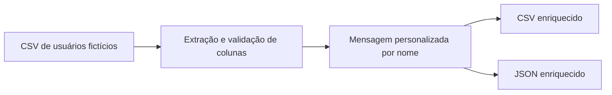

# Pipeline ETL com Python

**Projeto educacional inspirado na Santander Dev Week 2023 (DIO).** Extração de CSV, transformação de registros e exportação em CSV/JSON, usando somente a biblioteca padrão do Python.

[Portfólio](https://github.com/Enzo-Zapparolli) · [Código](src/main.py) · [Base fictícia](data/users.csv)

## Fluxo



A transformação utiliza um texto fixo personalizado pelo nome. Não há integração com IA generativa, API bancária ou envio de mensagens a pessoas.

## Executar

Com Python 3.10 ou superior:

```bash
git clone https://github.com/Enzo-Zapparolli/santander-dev-week-etl-python.git
cd santander-dev-week-etl-python
python src/main.py
```

Não é necessário instalar pacotes externos. As saídas são gravadas em `output/users_with_messages.csv` e `output/users_with_messages.json`. Uma nova execução substitui as saídas anteriores.

## Entrada e saída

A entrada exige as colunas `id`, `nome`, `conta` e `cartao`. O conjunto incluído contém cinco registros fictícios. A transformação acrescenta a coluna `mensagem`, preservando os demais campos.

Exemplo de registro de saída em JSON:

```json
{
  "id": "1",
  "nome": "Ana Souza",
  "conta": "0001-9",
  "cartao": "**** **** **** 1234",
  "mensagem": "Ana Souza, acompanhe seus gastos, defina metas mensais e use seu cartão com consciência para fortalecer sua saúde financeira."
}
```

## Organização

| Caminho | Responsabilidade |
| --- | --- |
| `data/users.csv` | Entrada fictícia |
| `src/main.py` | Funções de extração, transformação e carga |
| `output/` | Resultados gerados localmente |
| `requirements.txt` | Registra que não há dependências externas |

## Decisões e limites

O CSV local permite reproduzir o fluxo sem depender da API do desafio original. O código verifica a existência do arquivo e das colunas obrigatórias. Não há orquestração, carga incremental ou validação completa dos valores; o objetivo é demonstrar um ETL local simples.

**Autor:** Enzo Zapparolli · [LinkedIn](https://www.linkedin.com/in/enzo-zapparolli-5b4420348/).
